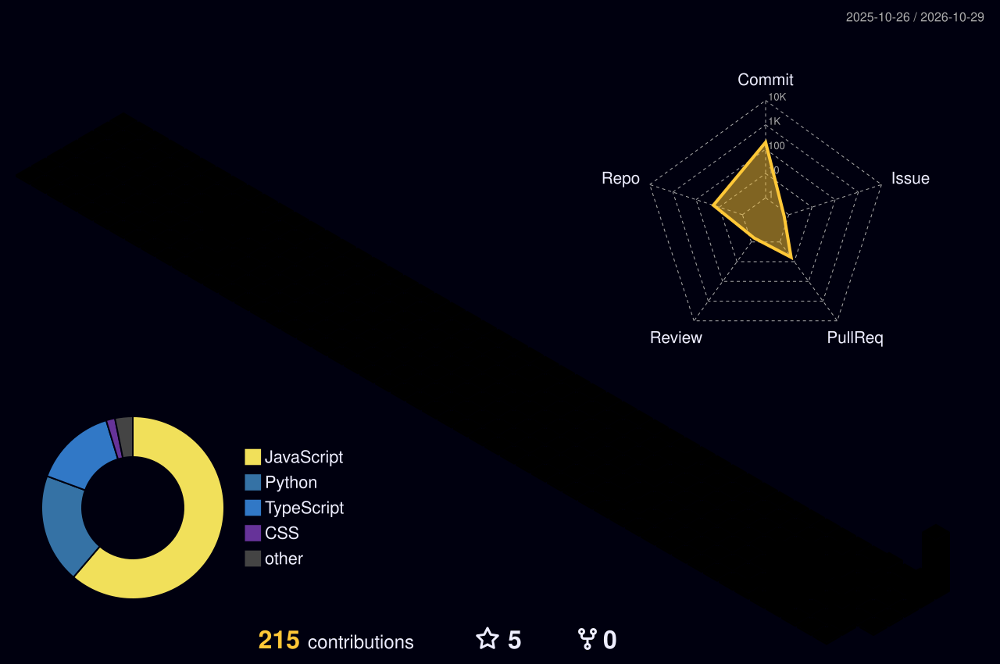

  

  
  

CS graduate (LIU, 2026), freelancing since early 2025, and incoming student at 42 Beirut.

I build small products that real businesses actually use — an NGO platform, an e-commerce store for a family business, booking sites for my own arcade rental company. I care about the boring parts too: clear requirements, a clean data model, and shipping something that keeps working after launch.

---

### Experience

**Freelance Full-Stack Developer** — Feb 2025 – present  
Websites and web apps for NGOs and local businesses in Lebanon (YARD, LIVRE, DAX, Next Level Game).

**AIY Expert Solutions — Developer Internship** — 2026  
Built an automation system that completes confirmed checkout jobs end-to-end on a test e-commerce store, benchmarked over 100 runs.

**DecodeLabs — Internship** — 2026  
Generative AI and Full-Stack tracks. Built Python + Gemini API tools (chatbot with memory, copywriting engine, image studio, code reviewer) and a responsive task manager.

**YARD / SHiFT Social Innovation Hub** — Front-End / Full-Stack Developer & volunteer  
Built the bilingual platform used by the youth hub in Tripoli.

---

### Live work

| Project | What it is | Stack |
|---|---|---|
| [**YARD Platform**](https://github.com/Moemenakari/yard-platform) | Bilingual (AR/EN) platform for YARD, a youth initiative of SHiFT Social Innovation Hub · [yardbplatform.com](https://www.yardbplatform.com) | TypeScript |
| [**LIVRE**](https://github.com/Moemenakari/livrelb) | Online store for a Lebanese custom-jewelry shop sold through Instagram — one shared catalog for 5 sellers plus a customer database · [shop.livrelb.workers.dev](https://shop.livrelb.workers.dev) | TypeScript, Cloudflare Workers |
| [**DAX**](https://github.com/Moemenakari/dax) | E-commerce site for a clothing store (client project) · [dax-clothes-store.vercel.app](https://dax-clothes-store.vercel.app) | Next.js 15, TypeScript, Redux Toolkit, MySQL, Docker, Cloudinary |
| [**O HUB**](https://github.com/Moemenakari/ADate) | Phone-first community PWA — chat, groups, mini-games and a coins system · [adate.vercel.app](https://adate.vercel.app) | JavaScript, Neon Postgres, Web Push, Vercel |
| [**Next Level Game**](https://github.com/Moemenakari/seniorarcades) | Website for my arcade-machine rental business for events · [nlg-arcade-frontend.vercel.app](https://nlg-arcade-frontend.vercel.app) | React, Tailwind CSS |
| [**Indomie Lebanon concept**](https://github.com/Moemenakari/indomie-lebanon-concept) | Unofficial 3D homepage concept — a UI/front-end experiment for Lebanese brands · [indomie-lebanon-concept.vercel.app](https://indomie-lebanon-concept.vercel.app) | React, TypeScript, Three.js |

### DecodeLabs internship projects

- [**memory-chatbot**](https://github.com/Moemenakari/memory-chatbot) — terminal chatbot with sliding-window conversation memory
- [**copy-tone-transformer**](https://github.com/Moemenakari/copy-tone-transformer) — marketing copy for LinkedIn / Instagram / email with tone control and async calls
- [**image-studio**](https://github.com/Moemenakari/image-studio) — text-to-image studio (Streamlit + CLI) with presets, retries and integrity checks
- [**code-reviewer**](https://github.com/Moemenakari/code-reviewer) — CLI that explains code, ranks bugs by severity and returns a refactored version
- [**taskflow**](https://github.com/Moemenakari/taskflow-p1) — responsive task manager in vanilla HTML, CSS and JavaScript

---

### Skills

  

**Languages:** JavaScript, TypeScript, Python, SQL, HTML, CSS  
**Front-end:** React, Next.js, Redux Toolkit, Tailwind CSS, Three.js, PWAs, responsive & bilingual (RTL) UI  
**Back-end:** Node.js, REST APIs, PostgreSQL (Neon), MySQL, Cloudflare Workers, Web Push  
**AI:** Gemini API, prompt design, Streamlit  
**Data:** Hadoop, Spark, Hive, Talend  
**DevOps & tools:** Git/GitHub, Docker, Vercel, Cloudinary  

---

### Contributions

  

  

---

### Off the keyboard

Scout troop leader, Lebanese Red Cross volunteer, and I run [Next Level Game](https://nlg-arcade-frontend.vercel.app), an arcade rental business — so I've seen software from the customer's side too.

Open to junior full-stack / front-end roles, on-site in Lebanon or remote.

